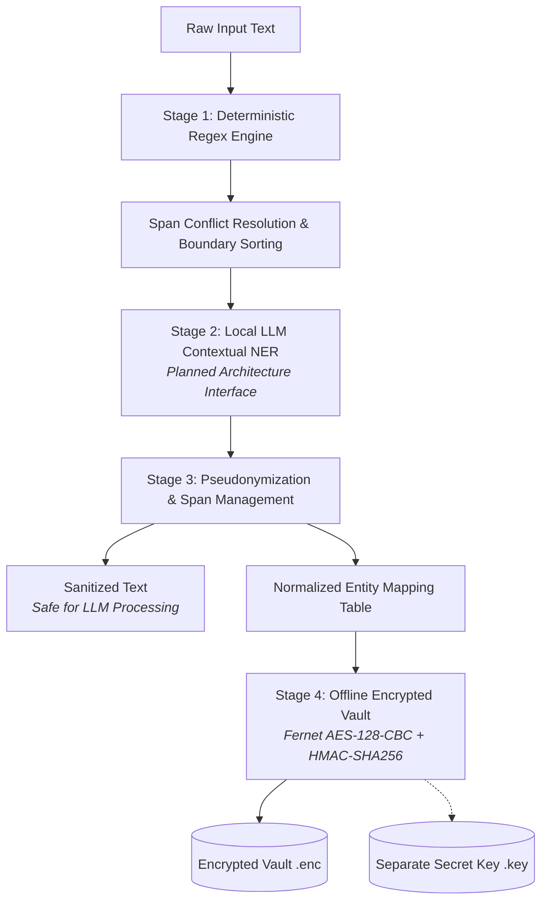

# PIIGuard

**Offline PII Detection and Pseudonymization Pipeline**

PIIGuard is a lightweight, privacy-focused offline Python pipeline designed to detect sensitive Personally Identifiable Information (PII) in unstructured text and replace it with synthetic surrogates. Engineered for local execution, PIIGuard prevents sensitive data leakage into downstream Large Language Models (LLMs) and external analytics services while maintaining an encrypted offline vault for deterministic mapping recovery. The current implementation provides deterministic pattern extraction, consistent pseudonymization, and an encrypted offline vault, with local LLM contextual NER designed as an extensible interface.

---

## Overview

Submitting raw text to cloud-hosted or centralized language models creates severe privacy and compliance risks. Personal contact details, government identifiers, and infrastructure addresses can be ingested and memorized by models.

PIIGuard addresses this challenge through a privacy-preserving preprocessing architecture:
1. **Detects** sensitive identifiers using deterministic, precompiled regular expressions.
2. **Pseudonymizes** detected entities right-to-left using synthetic surrogates from Indian locales.
3. **Encrypts** the reversible entity mapping offline using Fernet authenticated cryptography before the sanitized text is routed downstream.

---

## Key Features

- **100% Offline Processing:** Runs entirely in local memory with zero network dependencies, telemetry, or external API calls.
- **Deterministic Pattern Extraction:** Precompiled regex patterns for structured identifiers with strict octet validation and greedy span overlap resolution.
- **Consistent Pseudonymization:** Uses Faker (`en_IN` locale) with canonical entity normalization so identical entities across a document receive identical synthetic surrogates.
- **Right-to-Left Span Replacement:** Replaces entity spans in reverse character order to prevent index drift and text distortion.
- **Encrypted Offline Vault:** Secures mapping tables using Fernet authenticated symmetric encryption (AES-128-CBC + HMAC-SHA256) stored in `.enc` files with separate key storage.
- Sensitive Input and Mapping Keys Withheld from Normal Console Output: Normal CLI output omits raw inputs and plaintext mapping keys for detected structured identifiers. Regex-based detection may miss unstructured personal information.
- **Contextual Extraction Interface:** Modular multi-stage pipeline designed to interface with local quantized LLMs for semantic entity recognition.

---

## Architecture



---

## Supported PII Types

| Entity Type | Label | Pattern Description | Limitations |
| :--- | :--- | :--- | :--- |
| **Email Address** | `EMAIL` | RFC 5322-compliant subset with boundary guards | Matches syntactic format; does not verify inbox existence. |
| **Indian Mobile Number** | `PHONE` | 10-digit mobile numbers with optional `+91`, `91`, or `0` prefixes, spaces, and hyphens | Matches structured mobile numbers starting with 6–9; does not verify active carrier assignment. |
| **Aadhaar Number** | `AADHAAR` | 12-digit numbers formatted as 4-4-4 (spaces or hyphens) or 12 continuous digits | Matches structural syntax only; does not perform UIDAI Verhoeff checksum validation or verify issuance. |
| **Permanent Account Number** | `PAN` | 10-character alphanumeric syntax (`[A-Z]{5}[0-9]{4}[A-Z]`) | Matches structural pattern; does not query Income Tax department databases. |
| **IPv4 Address** | `IP_ADDRESS` | Dotted-quad notation with validated octet values $0 \le \text{octet} \le 255$ | Validates numeric range; rejects octets $> 255$ (e.g. `999.1.1.1`). |

*Note: Unstructured identifiers (such as person names and physical addresses) require contextual NER and are targeted in Stage 2 local LLM integration.*

---

## Technology Stack

- **Language:** Python 3.12
- **Package & Environment Management:** [`uv`](https://docs.astral.sh/uv/)
- **Synthetic Data Generation:** [`faker`](https://faker.readthedocs.io/) (`en_IN` locale)
- **Cryptography:** [`cryptography`](https://cryptography.io/) (Fernet / AES-128-CBC + HMAC-SHA256)
- **Testing:** [`pytest`](https://docs.pytest.org/)

---

## Project Structure

```
PIIGuard/
├── pyproject.toml           # Project metadata, dependencies, and pytest configuration
├── uv.lock                  # Pinned dependency lockfile
├── README.md                # Project documentation
├── main.py                  # End-to-end local demonstration CLI
├── src/
│   ├── __init__.py          # Source package marker
│   ├── piiguard/            # Top-level module exports
│   │   ├── __init__.py
│   │   └── py.typed
│   ├── stage1_regex.py      # Deterministic regex extraction engine
│   ├── stage3_pseudonym.py  # Pseudonymizer with Indian Faker locale & right-to-left replacement
│   └── vault.py             # Offline Fernet-encrypted mapping vault
├── tests/
│   └── test_cases.py        # Comprehensive test suite (34 passing tests)
├── data/                    # Local working directory (git-ignored)
└── results/                 # Encrypted vault artifacts (git-ignored)
```

---

## Installation

Clone the repository and synchronize dependencies using `uv`:

```bash
git clone https://github.com/anya2203/PIIGuard.git
cd PIIGuard
uv sync
```

---

## Usage

Run the integrated pipeline demonstration with synthetic benchmark data:

```bash
uv run python main.py
```

To run against custom input text:

```bash
uv run python main.py --text "Contact jordan.lee@example.org or +91 98765 43210 regarding PAN ABCDE1234F."
```

*Note: Supplying sensitive text via `--text` may expose it to local process listings or shell history. Use `--file` or pipe input for production workloads.*

To run in-memory without saving vault files to disk:

```bash
uv run python main.py --no-save
```

### Representative Example

```
Input:
Contact jordan.lee@example.org or +91 98765 43210 regarding PAN ABCDE1234F.

Pseudonymized Output:
Contact person@example.org or [SYNTHETIC_PHONE] regarding PAN [SYNTHETIC_PAN].
```

---

## Testing

Execute the automated test suite with `pytest`:

```bash
uv run pytest -v
```

**Verified Test Results:**
- Last verified test run: 34 tests passed.
- Covers regex extraction, octet boundary validation, exact span offsets, right-to-left replacement, repeated entity mapping consistency, vault encryption/decryption round trips, atomic exclusive-creation race condition prevention (no-clobber), tamper detection, terminal output privacy across stdout/stderr with multiple synthetic canaries, and offline socket isolation.

---

## Privacy and Security

- **Strict Offline Operation:** PIIGuard does not make outbound network requests or transmit data to cloud endpoints.
- **Terminal Output Safety:** Default execution withholds raw inputs and plaintext mapping keys from console logs.
- **Separate Key Storage:** Encryption keys are never embedded in ciphertext vault files (`.enc`).
- **Filesystem Security Limitations:** Configuring `.gitignore` prevents files from being tracked in Git, but does not secure files on disk. Restrictive file permissions (`0o600`) and OS-level access controls should be maintained.
- **Irreversible Key Loss Notice:** Fernet encryption provides mathematical security without backdoors. If the `.key` file is lost, recovering original mappings is impossible.
- **No Anonymity Guarantee:** Pseudonymization replaces direct identifiers with synthetic surrogates, but does not guarantee absolute anonymity or eliminate re-identification risk from quasi-identifiers or background knowledge.
- **Git Exclusions:** `.gitignore` excludes `.venv/`, `*.key`, `*.enc`, `.env`, and data directories to prevent accidental repository leaks.

---

## Authors

- **Ananya Manoharan**
- **Anuj Srinivas**
---

## Future Improvements

- Integrate quantized local LLMs (via Ollama or llama.cpp) for contextual entity extraction (names, designations, physical addresses).
- Implement hybrid span resolution combining deterministic regex patterns and model confidence scores.
- Build a reverse deanonymization module to restore sanitized LLM outputs using vault keys.
- Add support for regional business identifiers (e.g., GSTIN, CIN, and driving licenses).
